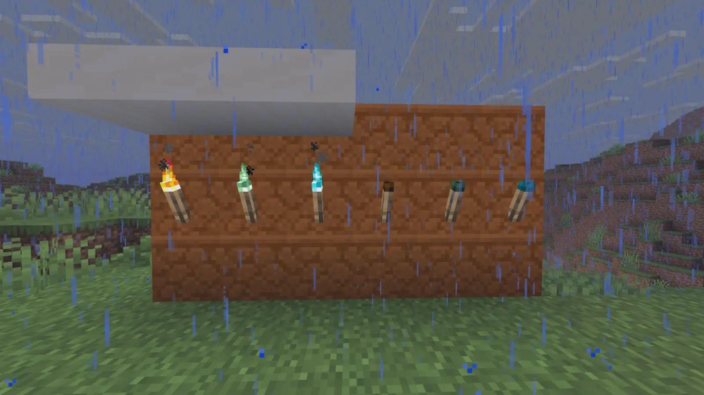

<!-- page: introduction -->

<p class="eyebrow">For Klei · A companion to your living-world video</p>

# Retold

<p class="subtitle">A living-world field guide</p>

I've been working on a Minecraft mod called Retold. Your video, [How can we make Minecraft feel alive? (It isn’t structures)](https://www.youtube.com/watch?v=cBmt2FNP1Ug), made me want to share the parts you might enjoy playing with.

Animals need food, remember places, and react to one another. They can consume the plants around them, move toward better feeding grounds, hunt, flee, and breed when their needs are met. I’m interested in what happens when those rules meet the place you build in.

Retold also changes crafting, magic, villages, and progression. This guide starts with the ecology. You can try it immediately in a Creative playground, or start a Survival world and meet the systems as you go.

### Three connections to your video

| Your principle | Something to look for in Retold |
| --- | --- |
| **Sympathy** | Different diets, daily rhythms, homes, and senses give familiar animals reasons to act. |
| **Feedback loops** | Forage is eaten; food shortages can move a herd; births create more mouths to feed. |
| **Stewardship** | A reachable food supply and safety support breeding and make a place worth staying in. |

This is an experiment with those kinds of interactions. There is no lichen-and-substrate succession system, and long-term ecosystem balance still needs more playtesting.

<aside class="note"><strong>About the development.</strong> I use AI assistance for development, and some development artwork is generated. The design direction is mine. The project’s credits describe the artwork and its status.</aside>

### Pick a way in

- **Start a Survival world:** [the opening changes, page 2](#getting-started).
- **Follow the ecology:** [food and ranges, page 3](#food-and-ranges).
- **Try things straight away:** [the playground, page 7](#playground).

<p class="edition">Retold 0.5.0 alpha · Minecraft 26.2 · NeoForge 26.2.0.7-beta · Java 25<br>Guide checked against the bundled build on 13 November 2026.</p>

<!-- page: getting-started -->

<p class="eyebrow">02 / Start playing</p>

## The opening is different

Use **Minecraft Java 26.2**, **NeoForge 26.2.0.7-beta**, and **Java 25**. Put **retold-0.5.0.jar** in the instance’s mods folder. It needs to be installed on both the server and every client for multiplayer. Start a fresh world; keep an existing save backed up before experimenting.

For a quick look, make a **Creative world with cheats** and turn to page 7. For Survival, these are the changes most likely to catch you out.

### From Flint to your first metal

1. **Gather Sticks and Flint.** Leaves can drop supplemental Sticks; Gravel supplies Flint. Logs do not drop wood when harvested bare-handed. Wooden and Stone equipment recipes are removed.
2. **Make a Flint Multi-tool** in the inventory grid. It harvests Logs and ordinary exposed Copper Ore, but not Stone or Deepslate Copper. Make a Crafting Table once you have wood.
3. **Build a Campfire.** It needs no Coal and starts unlit. Right-click with bare Flint to light it, consuming one Flint in Survival. Cook eight Clay Balls into eight Bricks; four positions allow two batches of about thirty seconds each.
4. **Build the Brick Furnace** from eight Brick items. This is the renamed vanilla Smoker. With suitable fuel it smelts Copper, cooks food, and turns Logs into Charcoal. Make a Copper Pickaxe, then collect Cobblestone for a normal Furnace.

<div class="recipe-grid" markdown="1">

<div markdown="1">

**Flint Multi-tool · 2×2**

```text
Flint  Flint
  ·    Stick
```

</div>

<div markdown="1">

**Campfire · 3×3**

```text
  ·   Stick   ·
Stick   ·   Stick
 Log   Log   Log
```

</div>

<div markdown="1">

**Brick Furnace · 3×3**

```text
Brick Brick Brick
Brick   ·   Brick
Brick Brick Brick
```

</div>

</div>

### Keep these rules in mind

- **Copper → Iron → Steel → Diamond.** Copper is slow on Stone. Steel is needed for Deepslate and Diamond Ore; a fuelled Blast Furnace turns Iron Ingots into Steel. Diamond is fragile until enchanted. [Full equipment route and recipes](player-guide.md#2-your-first-days-and-equipment).
- **Beds set spawn but do not skip night by default.** Shelter and lighting still matter. Exposed torches can go out in rain or snow; cover them and relight them with Flint and Steel or a Fire Charge.
- **An empty recipe book does not block valid manual crafting** under ordinary settings. Learn through making things and Villager lessons. The full handbook has the recipe diagrams if you get stuck.

<!-- page: food-and-ranges -->

<p class="eyebrow">03 / Food changes where animals live</p>

## A pasture can run out

A herd has a remembered feeding range. Animals graze, consume food, and return around that range. If hunger rises while usable forage is depleted, the herd can seek a better feeding ground. A suitable, accessible feeder near its range can make that move unnecessary.

<div class="flow" role="img" aria-label="Plants are eaten; food becomes scarce; hungry animals can seek a better range."><span>Plants are eaten</span><b aria-hidden="true">→</b><span>Food becomes scarce</span><b aria-hidden="true">→</b><span>A range can shift</span></div>

### Watch first, then change one thing

Find a few Cows in a grassy area. Watch what they eat and where they return. Then provide a reachable Animal Feeder with Wheat. You are changing the food supply that helps hold their range in place. This is also a way to maintain animals without repeatedly holding out food to lead them around.

A fence alone does not meet those needs. Desperate eligible land animals can break wooden fences and closed wooden gates. Hungry wild predators can breach the same barriers to reach prey. Cracking gives you a chance to notice; food and safety address the pressure behind it.

### Give the right food in the right way

| Animals | A useful starting point |
| --- | --- |
| Cows, Sheep, and other grazers | Reachable Wheat in a feeder, or suitable plants to graze. |
| Pigs, Chickens, and Rabbits | Suitable seeds or produce; their dropped-food diets are broader than vanilla breeding food. |
| Wolves | Suitable meat or fish; wild Wolves can also hunt prey. |
| Schooling fish | Maintain suitable aquatic plants. They do not use land-animal feeders. |

Dropped food, feeder food, habitat forage, and the ordinary right-click interaction are distinct routes. A Cow can eat a dropped Carrot even though Wheat remains its familiar direct interaction. Some specialist forage represents browsing without removing a block; other meals consume real plants.

### The Animal Feeder

Craft a two-row U from five Planks: two in the corners of one row, with three directly below them. It holds one stack. **Right-click with suitable food** to insert one item; **sneak-right-click** to insert as much of the held stack as fits. Sneak-right-click with an empty hand to retrieve it. Leave a clear approach beside the trough.

<aside class="note"><strong>Try this.</strong> Compare the same herd before and after supplying food. Movement is conditional: a blocked route or an unreachable meal will not work. Disabling mob griefing prevents destructive grazing and fence breaking; dropped food and accessible feeder meals can still work.</aside>

<!-- page: breeding -->

<p class="eyebrow">04 / Care changes populations</p>

## Give them a reason to thrive

Retold replaces instant item-triggered breeding with sustained care for supported animals. Feeding an adult relieves hunger. A pair can become ready to breed after both adults have remained well fed and safe for **five minutes at normal game speed**.

<div class="timeline"><strong>Food + safety</strong><span>Five minutes of sustained satisfaction</span><strong>A ready pair can mate</strong></div>

### What the pair needs

- **Continuous food satisfaction.** A single meal is not a promise that they will remain fed for the whole preparation period.
- **No panic, damage, or active combat target.** A predator on the other side of a fence can still make the place unsuitable.
- **A compatible adult nearby.** Ready partners need to be within eight blocks and able to complete normal mating behavior. Babies and adults still on their age cooldown cannot start another birth.

After a birth, the parents become hungrier and keep the normal age cooldown. More animals also mean more demand on the same pasture or feeder. Keeping the food supply working becomes an ongoing part of animal care.

### A small experiment

Put two adult Cows in a safe enclosure with an accessible Wheat feeder. Stay nearby so they remain active. Keep food available and watch for a birth after the satisfaction period and normal pairing time. If nothing happens, inspect food access and danger before adding more animals.

You can observe naturally, or use the page 7 commands to start with both Cows well fed. That removes the initial hunger variable; it does not create instant breeding or bypass the five-minute preparation.

### Where this differs from your Muskox proposal

Retold does **not** impose a population-count cap on breeding. This build does not establish a special production bonus for open space, sunlight, or an ideal herd size. A crowded group can still breed if its other requirements are met.

The present stewardship reward is a maintained population and a useful food source that can hold animals near their range. There is room to explore stronger positive rewards for good habitats. I would not describe the current system as a finished answer to humane farm design.

<aside class="note"><strong>Something to play with.</strong> Change food access before changing the enclosure size. Watch whether births, hunger, or movement change, and whether the result is readable without the debug display.</aside>

<!-- page: predators -->

<p class="eyebrow">05 / Predators have needs</p>

## A hunt has a cause

Wild Wolves, Foxes, Cats, and other supported predators have food needs and species-specific prey choices. A hungry Wolf can hunt Sheep, Rabbits, Chickens, or fish. Tamed Wolves and Cats do not start ordinary independent prey hunts.

A successful eligible prey kill relieves the hunter’s hunger and clears its current hunt target. The hunter pauses to feed. Whether it hunts again depends on its remaining hunger and state; this is **not a fixed forty-minute post-kill cooldown**.

<div class="flow" role="img" aria-label="Hunger can start a hunt; a successful meal reduces hunger and ends that current hunt."><span>Hunger creates pressure</span><b aria-hidden="true">→</b><span>A hunt can succeed</span><b aria-hidden="true">→</b><span>The meal reduces hunger</span></div>

### The prey changes the encounter too

Prey can flee a nearby hungry predator before being hit. Damage and danger can spread panic through nearby companions. After flight, remembered homes and ranges help shape where animals regroup.

The hunter uses sight, nearby audible activity, and short-range scent. It can search around clues and last-known positions instead of always knowing where prey is. Long or obstructed chases can tire an ordinary predator, slowing or ending its pursuit.

These rules can interrupt one another. An animal that is fleeing may abandon a meal, and a hunter that is feeding may stop its pursuit. Observation is useful because the same animal can behave differently as its needs change.

### Compare a fed Wolf and a hungry Wolf

Use a wild adult Wolf with suitable prey in a disposable playground. Inspect it, then compare hunger 0 with hunger 50 using the page 7 commands. Avoid hitting it: retaliation is a separate reason to attack. Leave room for both pursuit and escape.

Watching one kill does not demonstrate a balanced population. Watch what happens afterwards: whether hunger falls, the current target clears, the prey regroups, and the hunter finds another reason to act.

<aside class="note"><strong>Keep the distinctions.</strong> Polar Bears currently have no Retold hunger cycle. Ordinary loaded hunts do not establish your proposed universal removal of meat drops. Retold’s unloaded catch-up predation removes eligible prey without loot or experience, which is a separate process.</aside>

<!-- page: time-and-weather -->

<p class="eyebrow">06 / Time and weather</p>

## Come back and look again

Different species have different rhythms. Grazers tend to rest at night; Chickens return to their roost during inactive periods and rain. Ordinary predators also have active and resting periods. Hunger or danger can interrupt rest.

A home is usually a remembered position, not a newly generated building. These places help explain why a creature returns somewhere after feeding or fleeing.

### When you leave an area

Animals in unloaded chunks are not continuously acting out every missed tick. When they return, Retold can reconcile up to **seven Minecraft days** of missed ecosystem time using the world’s clock.

That catch-up can consume real food, advance eligible breeding preparation, resolve suitable wild predation, or relocate an eligible foodless group when a safe route exists. Closing a single-player save for a week does not itself advance that clock. This is also not general offline crop growth or a complete village economy.

Named and tamed animals have a one-health floor against starvation during this catch-up. That protection does not make them immune to ordinary loaded starvation or attacks.

### The environment reaches your base too

<figure class="reference-shot">

<figcaption>Rain and cover matter: sheltered torches remain lit beside exposed extinguished ones. Earlier development build, captured in game by Xefensor, 18 July 2026; this is not a capture of the bundled build.</figcaption>
</figure>

Cover ordinary, Soul, and Copper torches to keep weather off them. Relight extinguished ones with Flint and Steel or a Fire Charge. Beds do not skip night by default, so you can watch a place change through the day and night.

<!-- page: playground -->

<p class="eyebrow">07 / A small playground</p>

## Three things to try

Make a disposable **Creative world with cheats**, using ordinary active animals near ground level. Stay close so they keep ticking. Both Retold command roots require operator permission level 2. These are experiments; changing hunger deliberately is not a natural observation.

### 1 / Maintain a breeding pair

Use `/retoldbehavior sethunger 0` while looking at **each Cow in turn**. Give the two adults a safe enclosure and an accessible Wheat feeder. Keep food available and wait at least five minutes, then allow time for pairing. Compare with a second observation after changing access to food. Use `/retoldbehavior get` to see their current state.

### 2 / Change the food supply

Watch a Cow group’s range with `/retoldbehavior home`. In an open area, compare a depleted patch with an accessible nearby patch containing plenty of suitable forage. Look at a Cow and set hunger to **70** to make food pressure visible sooner. Then try a reachable Wheat feeder near the existing range. A move still requires a suitable destination and route; food somewhere beyond a barrier is not enough.

### 3 / Compare a fed and hungry hunter

Use a wild adult Wolf with suitable Sheep prey and space to move. Look at the Wolf and set hunger to **0**, then later **50**. Inspect its state, prey response, and hunger after a successful hunt. Do not attack it. Use a fresh subject if a previous fight or panic makes the comparison unclear. A chase or kill is conditional, not guaranteed on a timer.

### Look at the animal, then type

| Command | Use |
| --- | --- |
| `/retoldbehavior get` | Inspect the looked-at creature’s current state. |
| `/retoldbehavior home` | Inspect its remembered home or range. |
| `/retoldbehavior sethunger 0` | Make that creature well fed. |
| `/retoldbehavior sethunger 50` | Give it moderate hunger for a comparison. |
| `/retoldbehavior sethunger 70` | Increase food pressure for the range experiment. |

Single-creature commands target the eligible mob you look at within roughly 24 blocks. **0 is well fed; 100 is starving.** Setting hunger does not clear every other state or stop future hunger changes.

<aside class="note"><strong>The content gallery is separate.</strong> `/retold testworld` builds a gallery inside the current Overworld save. Its exhibit mobs are frozen and invulnerable. Use it for items and equipment; use ordinary active mobs for these experiments. Gallery portals and other interactive supplies can still have real effects.</aside>

<!-- page: further-exploration -->

<p class="eyebrow">08 / Explore further</p>

## There is more when you want it

You do not need to finish a progression route to play with the ecology. If you want to keep going, these systems connect the world to the player in other ways.

**Villages.** Villagers can use accessible communal food stores, Farmers can deposit surplus, and selected professions can tend livestock. Village-owned supplies and animals have property and reputation rules. The wider settlement economy is unfinished. [Handbook chapter 9](player-guide.md#9-living-with-villagers).

**Recipe knowledge.** Show a professional Villager a finished item in the teaching panel and pay the displayed Emerald cost to learn a supported recipe. The sample is returned. Valid unknown recipes can still be crafted manually under ordinary settings. [Chapter 3](player-guide.md#3-learning-recipes-and-villager-lessons).

**Enchanting.** Three-glyph inscriptions replace random table offers. Compare examples, experiment, or learn through completed enchanted-book transfers at an Anvil. Bookshelves do not increase table power. The handbook explains the interface without solving the alphabet. [Chapter 4](player-guide.md#4-enchanting-from-the-beginning).

**Later progression — spoilers in the reference.** The dragon changes the world’s stage; further expeditions lead toward the Dragon Egg ritual and the Aender. This guide leaves the solutions in the full handbook. [Chapters 10–14](player-guide.md#10-the-three-world-stages).

### What this build is still exploring

- **Ecology:** long-term population balance, marginal food patches, dense groups, and behavior across varied natural terrain need broader playtesting. Local population loss is possible.
- **Stewardship:** there is no breeding population cap or finished habitat-quality production reward. This is a different approach from the Muskox system in your video.
- **Scope:** plant succession and substrate renewal are absent. Aender rewards and travel systems, broader village society, and parts of progression remain unfinished.
- **Verification:** old saves, multiplayer, dedicated servers, and complete natural progression still have gaps. Code and automated checks do not establish every natural encounter.

### Reference and contact

The package includes **Retold-Player-Guide.html** and **Retold-Player-Guide.pdf** for detailed recipes, diets, commands, troubleshooting, and progression spoilers. This is the 11 November 2026 development edition whose mechanics form the basis of 0.5.0.

[Project and credits](https://github.com/xefensor/Retold) · [Issues](https://github.com/xefensor/Retold/issues) · [Discord](https://discord.gg/S3g98zEY8a) · [alex@alexejtusl.cz](mailto:alex@alexejtusl.cz)

<p class="closing">I wanted to give you something you could poke at and play with. I hope you find an interaction here worth following.<br><strong>— Xefensor</strong></p>
